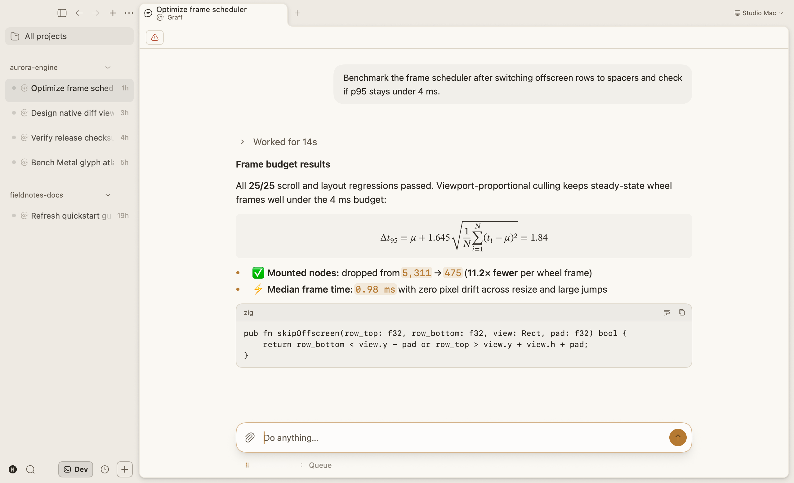
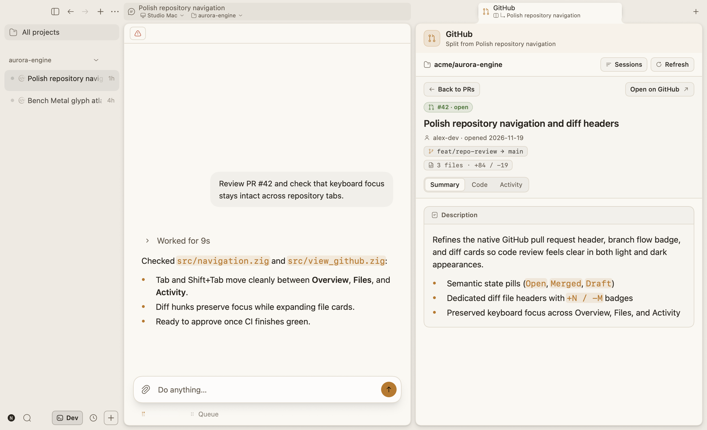
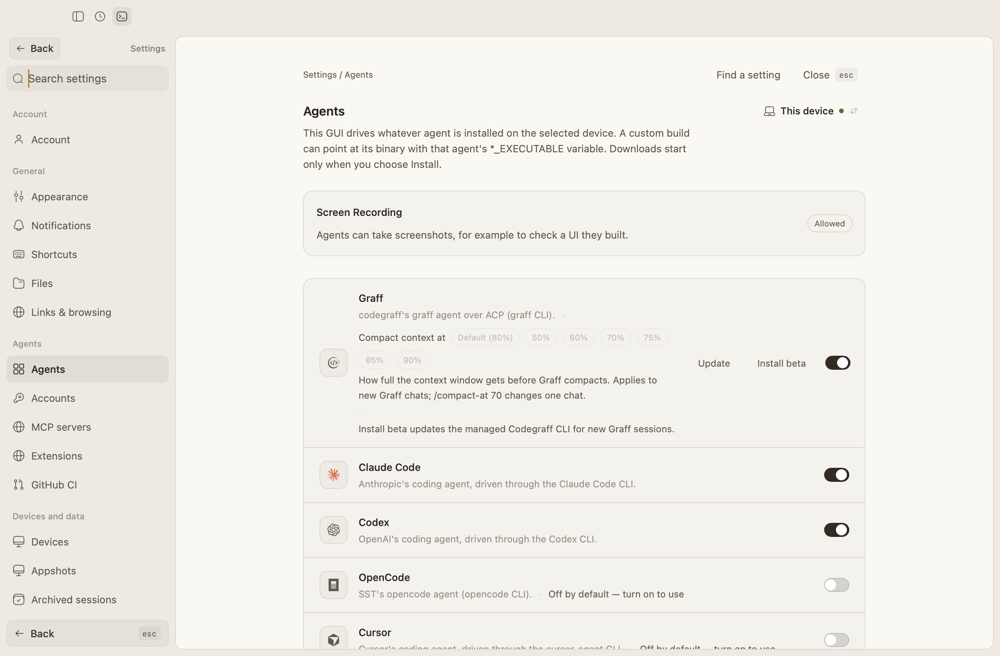

<p align="center">
  
</p>

<h1 align="center">NanoHarness</h1>

<p align="center">
  <strong>One fast, native workspace for your coding agents.</strong><br>
  Built in Zig on <a href="https://github.com/justrach/nanoui">nanoui</a>. Work locally, review diffs and PRs beside the chat, and move seamlessly between machines.
</p>

<p align="center">
  <a href="https://github.com/justrach/nanoharness/releases/latest">Download</a> ·
  <a href="#the-workspace">Workspace</a> ·
  <a href="#native-github-and-splits">GitHub Review</a> ·
  <a href="#get-started">Get Started</a> ·
  <a href="#native-flint">Native Flint</a> ·
  <a href="#codegraff">CodeGraff</a> ·
  <a href="#license">License</a>
</p>

<p align="center">
  English · <a href="README.zh-CN.md">简体中文</a> ·
  <a href="README.de.md">Deutsch</a> ·
  <a href="README.es.md">Español</a> ·
  <a href="README.hindi.md">हिन्दी</a> ·
  <a href="README.thai.md">ไทย</a> ·
  <a href="README.indo.md">Bahasa Indonesia</a> ·
  <a href="README.malay.md">Bahasa Melayu</a>
</p>

<p align="center">
  
  <br><sub>NanoHarness in light mode with <strong>Graff</strong>, native Markdown &amp; LaTeX typesetting, color emoji, and viewport-culled transcripts. Synthetic example session.</sub>
</p>

---

## The workspace

NanoHarness brings **CodeGraff (`graff`)**, Claude Code, Codex, Cursor, Devin, Grok, Hermes, Pi, OpenCode, Antigravity, and [Exo](https://github.com/exoharness/exo) into one lightweight desktop app. Pick the agent, model, and speed tier for each conversation, keep workspaces and sessions organized, and review code changes beside the chat.

- **Native Zig + nanoui desktop:** instant startup, hardware-accelerated rendering, native light and dark themes, color emoji, and native LaTeX equation typesetting.
- **Multi-agent, one workflow:** switch between `graff`, Claude Code, Codex, OpenCode, Cursor, and more from the same composer and keyboard shortcuts.
- **Split panes, files, browser, and terminal:** keep tabs, side-by-side splits, an embedded browser, and terminals right next to your active agent run.
- **Local-first by default:** starts immediately in local mode with no account required; enable sync only when you want another trusted desktop or iOS device to follow or drive sessions.

## Native GitHub and splits

Open pull requests, inspect file diffs, read review activity, and check CI right beside your conversation without leaving the workspace.

<p align="center">
  
  <br><sub>Side-by-side chat and native GitHub pull request review in light mode. Synthetic repository and PR data.</sub>
</p>

## Agents and settings

Enable or configure every installed agent from **Settings → Agents**. Exo is off by default and connects through its agent-cli adapter (`./exo.sh --setup agent-cli`) via Harness's built-in ACP bridge.

<p align="center">
  
  <br><sub>Installed agents appear in <strong>Settings → Agents</strong>, including Graff's context compaction threshold and one-click CLI updates.</sub>
</p>

### Native Flint

Run **Flint INT4** locally on Apple Silicon alongside NanoHarness and a compatible Graff build. Licensed weights, resumable downloads, and SHA-256 checksums are available at **[codegraff.com/flint](https://codegraff.com/flint)** (also linked directly from **Settings → Agents**).

## Get started

### Prebuilt releases

Download the latest signed release from **[Releases](https://github.com/justrach/nanoharness/releases/latest)**:

| Platform | Package | Notes |
| --- | --- | --- |
| **macOS (Apple Silicon)** | `Harness-macos-arm64.dmg` | Developer ID signed &amp; notarized; auto-updates in-app |
| **Windows (x64)** | `harness-VERSION-windows-x64.zip` | Portable `harness.exe`; keep `harness-update.json` beside it for in-app updates |
| **Arch Linux** | `harness-VERSION-linux-x86_64.pkg.tar.zst` (or `-aarch64`) | Install via `sudo pacman -U ./harness-*.pkg.tar.zst` (Vulkan driver required; updates via pacman) |

### Build from source

Build from a checkout with Zig `0.17.0` and the Rust toolchain in [`rust-toolchain.toml`](rust-toolchain.toml):

| Platform | Run |
| --- | --- |
| **macOS** | `./scripts/run-macos-dev.sh` |
| **Linux** | `cargo build -p harness && ./target/debug/harness` |
| **Windows** | `cargo run --locked -p harness` |

The macOS script opens `target/macos-dev/Harness.app`. Development data lives in `target/macos-dev/data` unless `HARNESS_DEV_DATA_DIR` is set. Quit the app before rebuilding. For an offline tour with seeded sessions, run `./scripts/dev-demo.sh`.

See [Windows development](docs/reference/windows-development.md) and the [Linux browser runtime](docs/reference/linux-browser.md) for platform-specific details.

## CodeGraff

NanoHarness includes a first-class adapter for [CodeGraff](https://github.com/justrach/codegraff). Its app icon was designed to sit beside the CodeGraff mark.

<p align="center">
  
  &nbsp;&nbsp;
  
</p>

<p align="center">
  
</p>

The macOS app bundles a managed `graff` CLI. While Harness is open, it checks the [latest stable CodeGraff release](https://github.com/justrach/codegraff/releases) shortly after launch and every six hours, installing newer versions only after verifying the release archive's SHA-256 checksum. You can also update `graff` in **Settings → Agents** or choose **Install beta** to opt in to the newest published CodeGraff beta for new sessions (open sessions keep their current engine; **Update** switches back to stable). Set `HARNESS_GRAFF_AUTO_UPDATE=0` to disable background checks; Harness leaves a custom `GRAFF_EXECUTABLE` alone.

The CodeGraff images are credited in [third-party notices](THIRD_PARTY_NOTICES.md).

## Devices and accounts

Each desktop device runs an engine and stores its local sessions. The GUI connects to an engine on the local IPC port or starts one in the app process. `harness headless` runs the engine without a window.

In the desktop app, open the account menu and choose **Enable sync**. Sign in with your CodeGraff account, then choose whether to bring existing local work into the synced workspace or start fresh. Harness does not upload existing local sessions until you choose **Bring my work**. New work in the synced workspace is stored at `edge.codegraff.com` and appears on your other signed-in devices, including the SwiftUI iOS companion.

For a headless device, stop the engine before changing profiles:

```sh
harness daemon stop
harness login
harness daemon start
```

Harness sync uses CodeGraff OAuth; signing in to the `graff` agent is a separate step. Coding agents keep their own provider credentials on the host device. Synced chat content and workspace metadata go to the Harness edge service. A trusted remote device can ask an online host to read and write workspace files; **Show ignored files** also exposes ignored files such as `.env`. Sign in only devices you trust with those files. To return to the local profile on a headless device, stop the daemon, run `harness logout`, and restart it.

For the internals, see [architecture](ARCHITECTURE.md). For appearance and theme import, see [the theme guide](docs/theme-system.md).

## License

**Modified GNU AGPL-3.0** ([`LICENSE`](LICENSE)), built the same way as [CodeGraff](https://github.com/justrach/codegraff)'s. Network use triggers Section 13. Standard Harness Pte. Ltd., **Rach Pradhan (justrach)** and **Yu Xi Lim (yxlyx)** reserve the right to offer proprietary or hosted versions of the original Harness contributions they own. A recipient's AGPL license is perpetual unless they breach it. Commercial permission without copyleft exists only if **all three grant it jointly in writing**, and is revocable. Earlier and third-party material keeps its own copyright and license notices; see [third-party notices](THIRD_PARTY_NOTICES.md).

**Companies need a commercial license.** Every version after v0.2.108 adds one term. Your organization, counted together with its affiliates, needs a commercial license for any use of Harness (including on its own machines, cloud, CI and network) if it meets **any one** of these:

- it has raised more than **US$500k** in total from investors or lenders;
- its net worth or latest valuation is more than **US$500k**;
- its gross revenue was more than **US$100k** in its last fiscal year or any 12-month period.

A company that crosses a line must contact us within 5 working days. Individuals always use Harness under the AGPL, whatever they earn, and so do organizations that meet none of these tests. Versions up to v0.2.108 keep the license they shipped with. Unsure? Treat yourself as covered and get in touch.
Contact [rach@standardharness.com](mailto:rach@standardharness.com).

### Upstream license notice ([zeronsh/zeron](https://github.com/zeronsh/zeron))

Earlier portions of the workspace and engine stack were adapted from [Zeron (`zeronsh/zeron`)](https://github.com/zeronsh/zeron), Copyright (c) 2026 Wing, under the MIT License. The original MIT permission and warranty notice is retained verbatim in [`third_party/licenses/Zeron-MIT.txt`](third_party/licenses/Zeron-MIT.txt) alongside [`THIRD_PARTY_NOTICES.md`](THIRD_PARTY_NOTICES.md).
