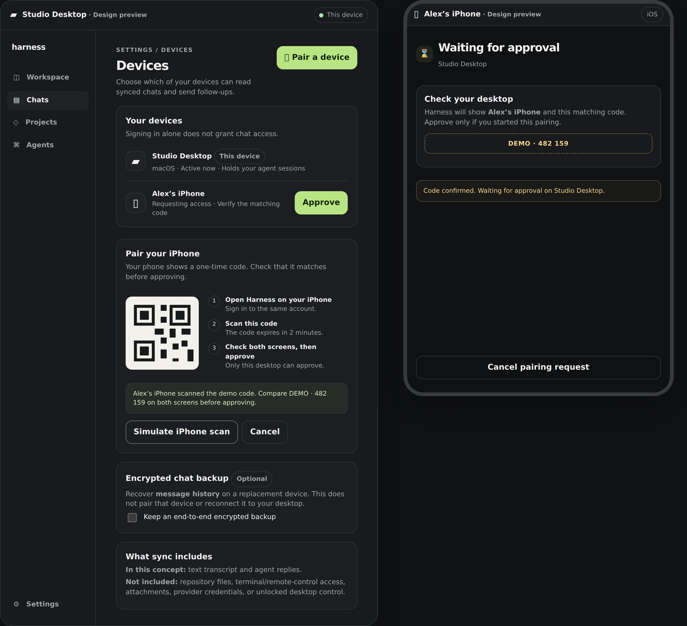
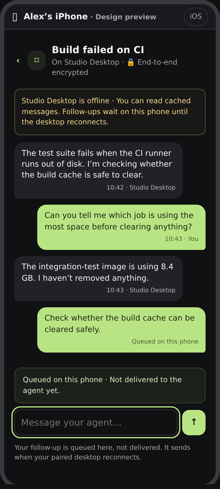
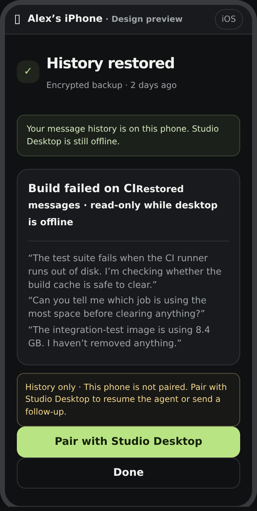

# Linked devices — design preview

Concept screenshots for opening the same Harness agent chat on your desktop and iPhone. All names, messages and codes are synthetic. These are screenshots of a prototype, not the shipped app or a demonstration of working encryption.

## 1. Pair your iPhone

Scan the code, compare the two screens, and approve the phone on your desktop.

## 2. Continue a chat while the desktop is offline

Read the cached conversation. A follow-up stays queued on the phone until the paired desktop can accept it.

## 3. Restore message history

A saved recovery key unlocks an optional encrypted backup. Restored history is read-only until the phone is paired separately.

